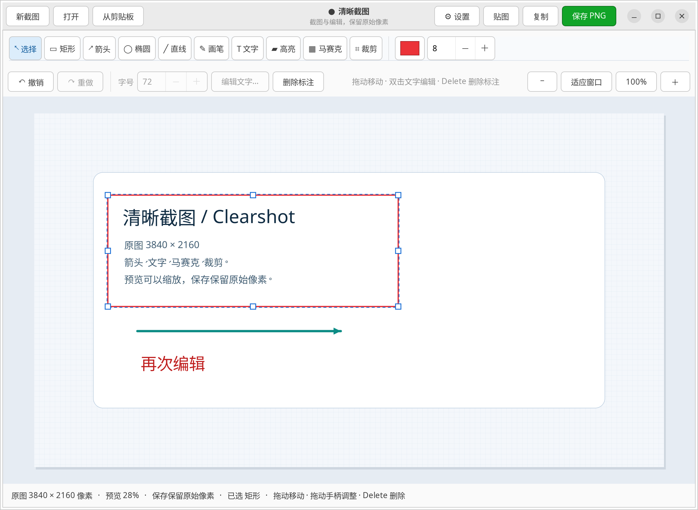
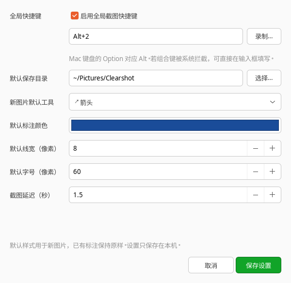

# 清晰截图 / Clearshot

面向 Linux GNOME / Wayland 的截图标注工具：系统负责截取原图，编辑器按原始像素标注。预览缩放不改变保存或复制的图像尺寸，适合 4K 显示器与 125% 等分数缩放场景。



## 安装

Ubuntu / Debian 安装运行依赖：

```bash
sudo apt update
sudo apt install python3 python3-gi python3-gi-cairo python3-cairo python3-pil \
  gir1.2-gtk-3.0 gir1.2-pango-1.0 xdg-desktop-portal \
  xdg-desktop-portal-gnome wl-clipboard
git clone https://github.com/motov3189/clearshot.git
cd clearshot
/usr/bin/python3 install.py
```

安装脚本只写入当前用户的 `~/.local/`。源码在原位置运行，移动源码目录后重新运行安装脚本即可更新入口。

在 GNOME 上可额外注册 **Alt + 2**（Mac 键盘对应 **Option + 2**）：

```bash
/usr/bin/python3 install.py --shortcut
```

默认不会修改快捷键，只有指定 `--shortcut` 时才注册。如果 Alt + 2 已被其他自定义全局快捷键使用，脚本会停止并提示。

程序设置中可以修改快捷键。再次运行 `install.py --shortcut` 会优先保留当前已注册的快捷键，不会把自定义组合键强制改回 Alt + 2。

不安装菜单入口也可直接运行 `/usr/bin/python3 app.py` 或 `/usr/bin/python3 app.py --capture`。其他桌面需要可用的 Screenshot Portal，尚未逐一验证。

## 使用

- **Option + 2**：启动系统截图，完成后进入编辑器。
- 应用菜单搜索 **清晰截图**：打开编辑器，也可以读取剪贴板或打开已有图片。
- 系统可能显示截图选区或共享确认窗口，这是 GNOME 提供的截图界面。
- `Ctrl + S` 保存无损 PNG，`Ctrl + C` 复制图片，`Ctrl + Z` 撤销，`Ctrl + Shift + Z` 重做。
- `V` 选择、`R` 矩形、`A` 箭头、`E` 椭圆、`L` 直线、`P` 画笔、`T` 文字、`H` 高亮、`M` 马赛克、`C` 裁剪。
- 选择工具后在图片上拖动；文字工具点击图片后输入文字。
- 标注完成后会自动选中：直接拖动可移动，拖动四周手柄可调整大小。箭头和直线可拖动两个端点手柄。
- 文字：拖动移动，拖四角缩放字号；双击文字或按 `Enter` / `F2` 再次编辑内容与字号；文字工具下单击已有文字也会重新编辑。
- 选中标注后，工具栏的颜色、线宽和字号会作用于该标注；`Delete` 删除，`Esc` 取消选择，方向键微调（`Shift` + 方向键移动 10 像素）。
- `Ctrl + 鼠标滚轮` 缩放预览；工具栏也提供“适应窗口”和“100%”。预览缩放不改变导出尺寸。
- 默认保存目录为 `~/Pictures/Clearshot/`。只在明确选择保存后写入图片。

## 设置

点击窗口顶部的 **⚙ 设置**，或运行 `clearshot --settings`。应用菜单的右键操作中也有“设置”入口。



可以自行调整：

- **全局截图快捷键**：启用或关闭；点击“录制”后按组合键，也可填写 `Alt+3`、`Ctrl+Shift+A` 等形式。Mac 键盘的 Option 对应 Alt。
- **默认保存目录**：选择已有目录，或填写新的绝对路径、`~/` 路径；保存图片时再创建目录。
- **新图片默认工具和样式**：工具、颜色、线宽、文字字号；已有标注不会因修改设置而被改写。
- **截图延迟**：0–10 秒，方便先打开菜单再截图。

点击“保存设置”后立即保存；快捷键在 GNOME 下直接生效，无需重启。程序会检查 GNOME 系统和自定义全局快捷键冲突；遇到冲突时保留原设置。如果快捷键已被系统拦截，无法录制，可直接填写组合键。设置窗口打开时，再按截图快捷键会回到设置窗口。

个人设置位于 `~/.config/clearshot/settings.json`（遵循 `XDG_CONFIG_HOME`）。该文件不在项目目录内，不会同步到 GitHub。文件写入失败时会恢复原来的快捷键；读取损坏的设置时先使用默认值，取消不会覆盖原文件。

## 清晰度

编辑数据以 PNG 原图的实际像素为准，不使用桌面逻辑分辨率作为导出尺寸。未标注的区域逐像素保留，3840×2160 的输入仍导出为 3840×2160。只有裁剪才会改变图片尺寸。

马赛克会直接修改原图像素。请自行检查遮盖效果；若需完全遮住敏感信息，可以使用其他方式彻底涂实，单纯马赛克不能保证内容无法推测。标注以独立图层绘制在马赛克之上。

## 可调整的标注

矩形、箭头、椭圆、直线、画笔、文字和高亮在导出前都保留为可编辑对象，不再合并成不可修改的像素。移动、缩放、改色、改线宽、改字号、删除和再次编辑文字都可以撤销/重做，最多保留 30 步，同时限制历史内存占用。

裁剪会同步平移标注，并丢弃完全落在裁剪区域外的标注。马赛克和裁剪属于破坏性操作，会直接修改底图像素；其余标注保持可编辑。

贴图使用普通 GNOME 窗口；Wayland 下程序不能强制决定窗口位置和置顶，可在标题栏右键菜单里选择“总在最上层”。不是 Snipaste 贴图行为的完整替代。

关闭编辑器后 Wayland 剪贴板图片由系统现有 `wl-copy` 保持。程序没有网络请求、OCR 云服务或后台截图监控；只在用户发起时调用桌面截图服务。截图源文件由 GNOME Portal 管理。

## 启动与依赖

```bash
clearshot                  # 编辑器
clearshot --capture        # 系统截图后编辑
clearshot --clipboard      # 编辑剪贴板图片
clearshot --settings       # 打开设置窗口
clearshot /绝对路径/图片.png
clearshot --demo           # 4K 示例，标注可直接调整，不截取桌面
```

依赖 Python 3、PyGObject / GTK 3、Pycairo、Pango、Pillow 和 wl-copy。请使用上面的系统包安装方式；仓库不包含二进制依赖或本地运行数据。

```bash
sudo apt install xvfb dbus-x11
/usr/bin/python3 -m unittest discover -s tests -v
GDK_BACKEND=x11 NO_AT_BRIDGE=1 xvfb-run -a /usr/bin/python3 tests/smoke_editor.py /tmp/clearshot-smoke
GDK_BACKEND=x11 GDK_SCALE=2 NO_AT_BRIDGE=1 xvfb-run -a \
  -s '-screen 0 2560x1920x24' /usr/bin/python3 tests/smoke_editor.py /tmp/clearshot-smoke-hidpi
GDK_BACKEND=x11 NO_AT_BRIDGE=1 xvfb-run -a \
  /usr/bin/python3 tests/smoke_settings.py /tmp/clearshot-settings-smoke
```

截图使用 [XDG Desktop Portal Screenshot v2](https://flatpak.github.io/xdg-desktop-portal/docs/doc-org.freedesktop.portal.Screenshot.html)，支持取消、错误响应与超时，订阅响应信号后再提交截图请求。Portal 测试使用私有 D-Bus 连接，不受当前桌面会话中的真实 Portal 干扰。

## 本机验证结果

2026-10-28：用户已在系统 125% 缩放下验证 Option + 2 → 系统截图 → 编辑 → PNG 保存，确认截图清晰、标注位置和保存均正常。2026-10-28 的可编辑标注版本新增 13 项单元/Portal 测试，全部通过；普通与 `GDK_SCALE=2` 的独立 GTK 窗口测试均通过，包括多种预览比例下的裁剪坐标、标注拖动/缩放手柄、文字重复编辑、4K 导出、剪贴板往返和贴图。

2026-11-05：新增设置窗口、个人配置持久化与全局快捷键管理测试。快捷键测试使用独立的内存设置后端，不会改动真实桌面。每次功能改动的文档和同步记录见 [CHANGELOG](CHANGELOG.md)。
